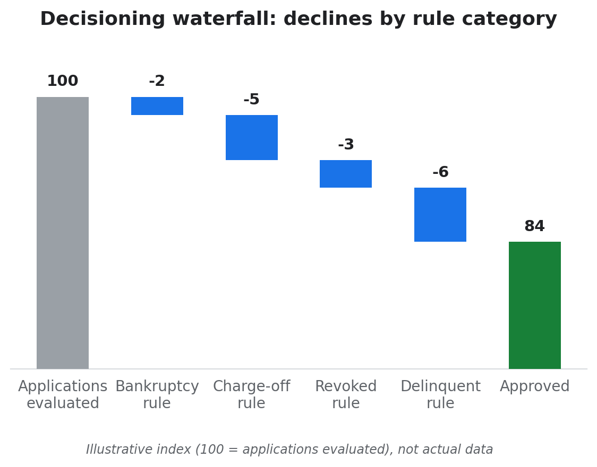
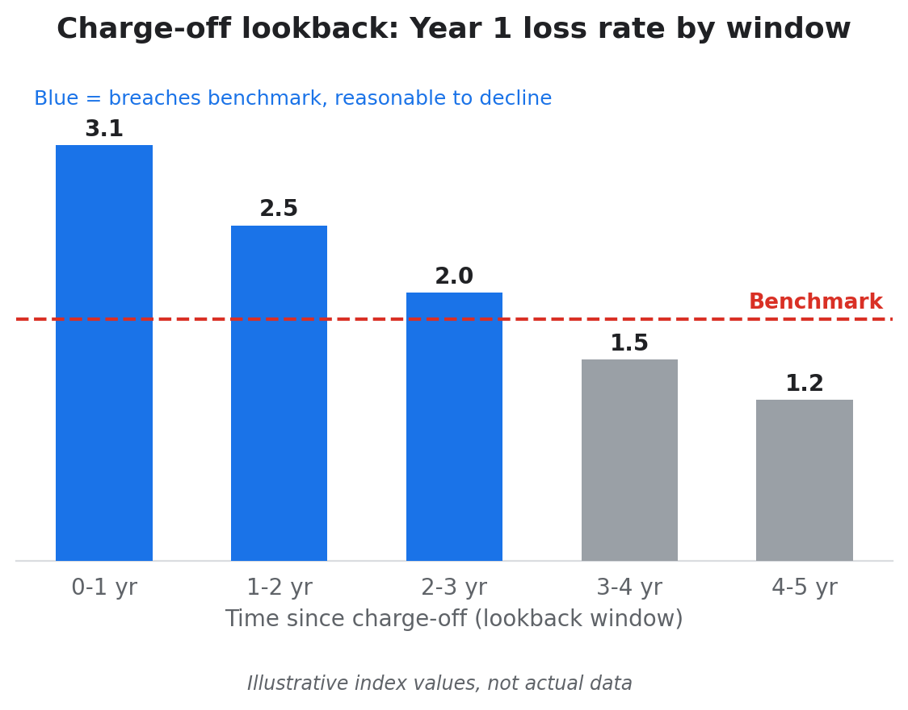
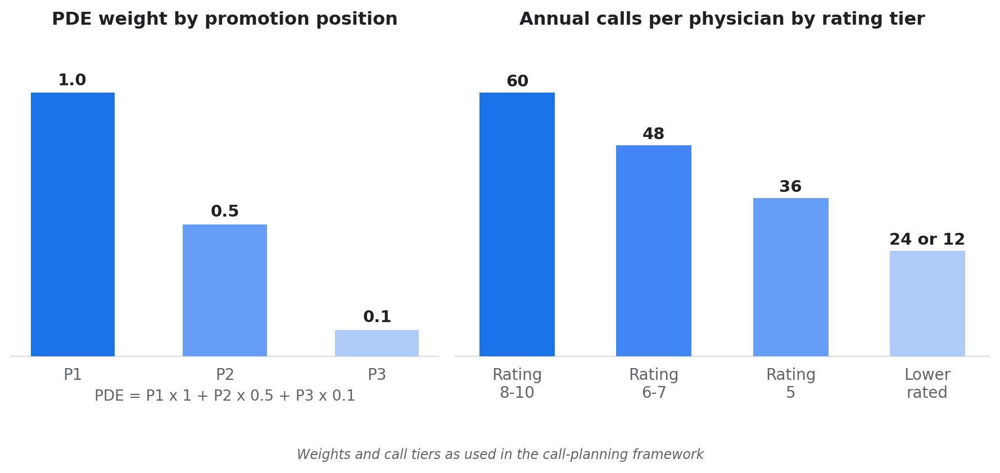
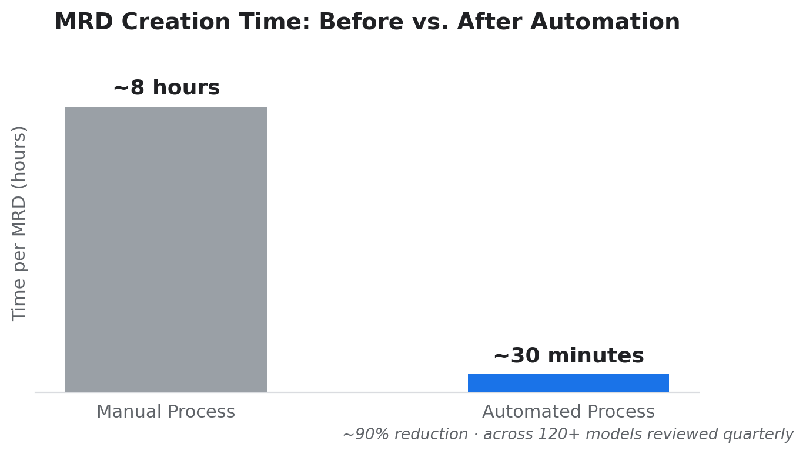
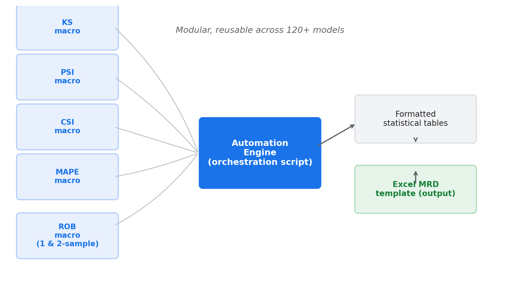
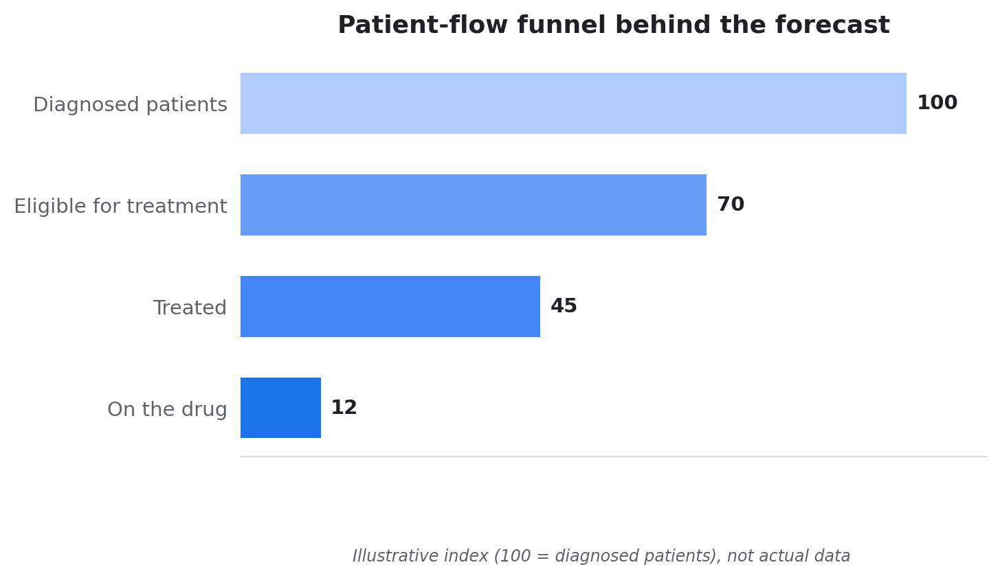
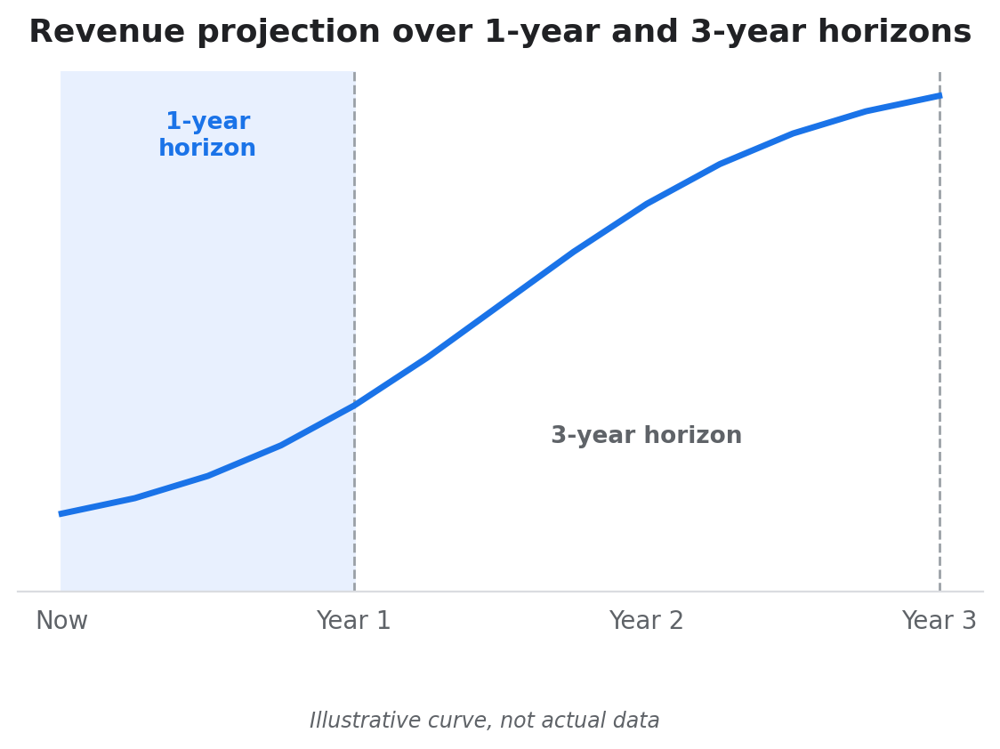

# Hi, I'm Deepali Sutar 👋

Data and analytics professional with 7 years of experience across financial services (Citi) and pharma consulting (ZS Associates). This page covers real work I've delivered: risk policy design, process automation, commercial resource allocation, and forecasting with client-facing team leadership.

*Looking for my product analytics learning projects instead? See [deepali-sutar.github.io](https://deepali-sutar.github.io/).*

*Note: client and employer details are anonymized, and charts marked "illustrative" show the shape of the work, not actual data.*

---

## Case Study 1: Standardizing Risk Policy Across Card Portfolios
**Can inconsistent risk policies across portfolios become one, without distorting approval rates?**

Citi's Retail Services co-branded card portfolios each ran their own version of existing customer management (ECM) rules: the policies governing bankruptcy, charge-off, revoked and delinquent accounts. Slightly different rules in each portfolio created operational complexity.

**Key finding:** Each candidate rule was tested against first-year performance versus risk benchmarks before it was recommended. The final standardized rules produced a net -0.01% change in approval rate at the overall level, with gains in some portfolios and losses in others, each justified by performance data.

*Illustrative: how applications flow through the four rule categories.*

**What I did:**
- Collated every ECM rule from each portfolio's specification and grouped them into four categories, identifying where variables and lookback periods differed
- Rebuilt the production decisioning waterfall independently from raw application-level data, then debugged it until it closely matched live production decisions
- Created flags to measure what each rule would do if applied to portfolios that didn't have it, and segmented lookback periods (for example 0-1 years up to 4-5 years for charge-offs) to find the best cut-off

*Illustrative: a lookback window is reasonable to decline when its first-year performance breaches the benchmark.*

- Pulled first-year performance for affected accounts and compared GCL unit and dollar rates to Risk Assessment Framework (RAF) benchmarks
- Aligned with a US-based director on one proposed rule per category, then built swap-in/swap-out views and a deck for the Acquisitions Strategy lead

**Tools used:** SAS · Excel · Risk Assessment Framework benchmarking

---

## Case Study 2: Allocating Sales Resources for a Drug Launch
**How do you launch a new drug's salesforce while protecting an existing priority brand?**

For a pharma client, sales rep calls are a finite resource: each rep had a fixed annual call capacity, distributed across physicians by rating tier. A new drug launch required a dedicated salesforce, built from reps on existing teams.

**Key finding:** Giving both the launch brand and the existing priority brand the primary promotion position in the restructured teams focused effort on the two brands that mattered most, as measured by Primary Detail Equivalents (PDE).

*Left: each position in a call carries a weight, and PDE sums them. Right: higher-rated physicians receive more calls per year.*

**What I did:**
- Merged physician and sales rep data to build alignments (which rep can target which physician), then distributed each rep's annual call capacity by physician rating tier (60 calls for the top ratings down to 12 for the lowest)
- Tracked promotion with PDE: a rep can promote 3 drugs per call, weighted 1.0 for first position, 0.5 for second and 0.1 for third, against PDE targets for each drug
- Moved a subset of reps from existing teams into a new launch team and set the launch brand and the existing priority brand at first position, with other brands in second and third
- Delivered on strict quarterly timelines, presenting findings regularly to the manager and client in the US

**Also:** led the migration of the call-planning workflow from SAS to R ahead of SAS decommissioning, reducing project costs by about 90%.

**Tools used:** SAS · R · SQL · Javelin Call Plan Designer (proprietary ZS tool)

---

## Case Study 3: Automating a Manual 8-Hour Compliance Process
**Can a quarterly compliance process covering 120+ models run in about 30 minutes per model instead of 8 hours?**

At Citi, model monitoring required Model Review Documents (MRDs) for 120+ decision models every quarter. Each one was a manual, roughly 8-hour process prone to error.

**Key finding:** A modular SAS macro framework cut MRD creation to about 30 minutes per model, roughly a 90% time reduction, while removing manual calculation errors from a compliance-critical process.

**What I built:** A modular SAS macro for each statistical metric (KS, PSI, CSI, MAPE, and both one-sample and two-sample Rank Order Break), each independently callable and reusable across model types. A central automation script orchestrates these macros, formats the output into the required tables, and exports directly into the Excel MRD template. This modular design let one codebase work across 120+ models with different underlying data structures.

**Tools used:** SAS · Excel · KS, PSI, CSI, MAPE, Rank Order Break

---

## Case Study 4: Forecasting and Client Delivery for a European Pharma Client
**What does patient-flow-based forecasting look like when you are also leading the delivery team?**

As the Business Insights and Analytics lead for a pharma client's Italy market, I managed the India-based team supporting forecasting and reporting across Oncology, Hematology and Immunology, working directly with the client team in Rome.

**Approach:** I forecasted revenue by estimating how many patients moved through each stage of care, from diagnosis to treatment with the drug, rather than extending past sales trends. Every projection could be traced back to patient numbers at each stage.

*Illustrative: patient-flow stages that drive the forecast.*

**What I did:**
- Led a team of 3 analysts, owned client requests end to end and turned them into team workstreams
- Built Excel-based patient-funnel forecasting models projecting units and revenue over 1-year and 3-year horizons

*Illustrative: projections over the two planning horizons.*

- Built reporting dashboards for ongoing performance tracking
- Presented forecasts and findings regularly to the client's associate director of Business Insights and Analytics, and spent several weeks on-site in Rome working with the client team

**Tools used:** Excel · Epidemiology-based forecasting

---

## Get in touch

Open to remote and international opportunities in data and analytics.

[LinkedIn](https://www.linkedin.com/in/deepali-gopal-sutar/) · [Email](mailto:deepali0298@gmail.com)
